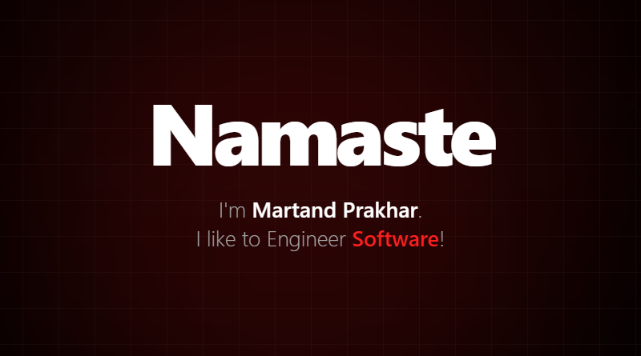
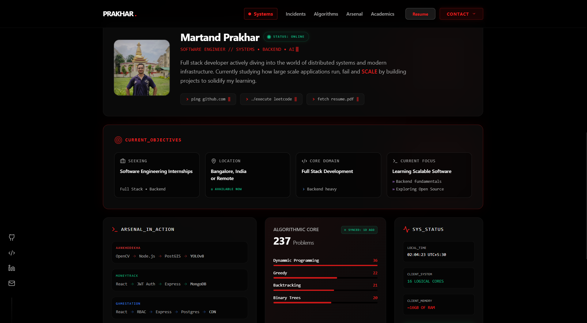
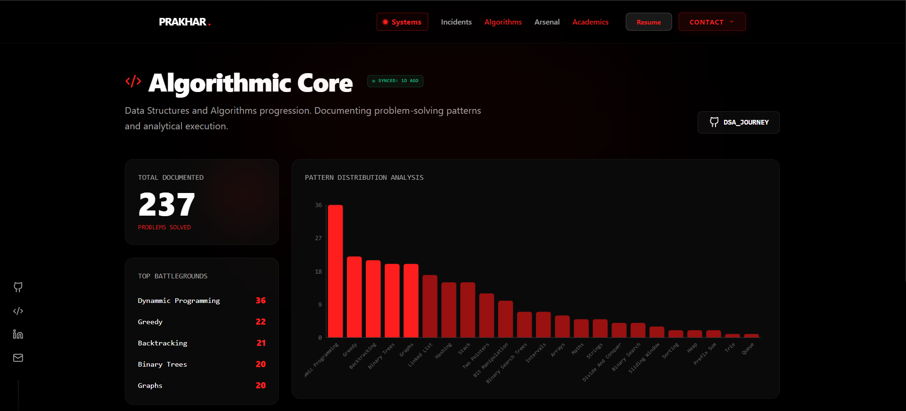
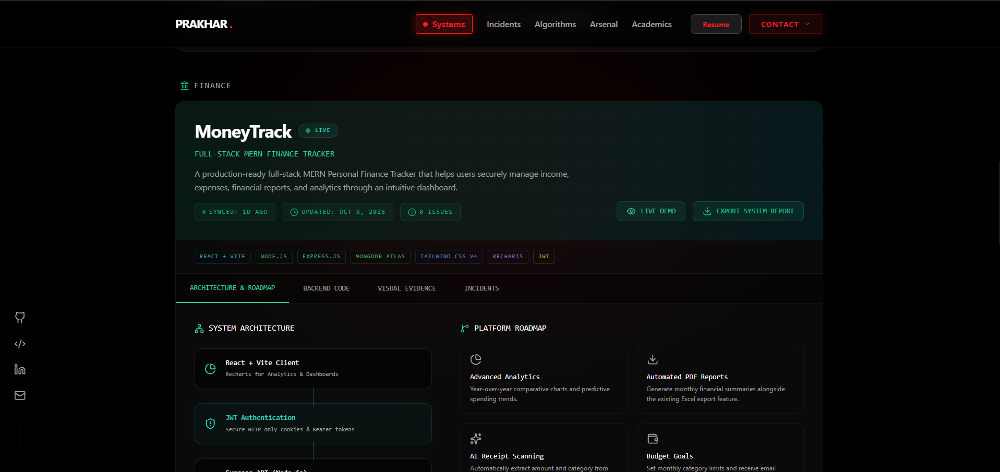
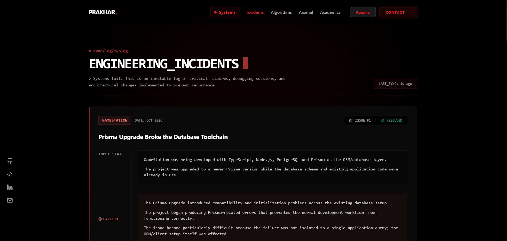

# Software Engineering Portfolio

A data-driven, Single Page Application (SPA) built to showcase software engineering projects, problem-solving progression, and technical architecture. This portfolio is engineered with a strict separation of concerns, decoupling the presentation layer from the underlying data using a static JSON architecture.



## 🏗️ Architecture & Core Concepts

Instead of hardcoding content into React components, this application is designed as a dynamic rendering engine. Content scales effortlessly without requiring UI modifications.

### 1. Automated Data Layer
All major sections of the portfolio read from strict JSON schemas located in `src/data/`:
- **`projects-data.json`**: Acts as the single source of truth for project metadata, telemetry, and external links. 
- **`dsa-data.json`**: Stores chronological Data Structures and Algorithms progress.
- **`incidents-data.json`**: An event-logging ledger that populates the timeline.

This "Automation-First" approach allows for continuous integration of new content—simply updating the JSON structures automatically populates the UI with new cards, charts, and metrics.

### 2. Data Visualization (Recharts)

The **Algorithms** route features dynamic data visualization. It parses `dsa-data.json` to calculate aggregate frequencies across various algorithmic paradigms (Dynamic Programming, Graphs, etc.) and renders a responsive bar chart using `Recharts`, providing a quantitative view of problem-solving metrics.

### 3. Component Architecture & State Management
- **Middleware Design (`BootGuard`)**: Implements an initialization wrapper that intercepts the first load. It utilizes `sessionStorage` to persist the "booted" state, ensuring the initial heavy animations only run once per session, preventing UX friction on page reloads.
- **Isolated Project Systems**: Each major project (e.g., `AankhoDekha`, `MoneyTrack`) has a dedicated, isolated component inside `src/Components/Systems`. This allows project-specific UI logic (like nested tabs or specific visual states) to exist without cluttering the global layout.
- **Markdown Parsing**: Project deep-dives and evidence are written in standard Markdown and parsed at runtime using `react-markdown`. This allows for highly readable documentation directly within the UI.



### 4. Routing & Error Handling
Built on `react-router-dom`, the application features standard SPA routing along with a custom `NotFound.tsx` component. The 404 page intercepts invalid routes and mimics a terminal execution error, utilizing the `useLocation()` hook to dynamically display the erroneous path.



---

## 🛠️ Tech Stack

- **Core**: React 18, TypeScript, Vite
- **Styling**: Tailwind CSS for utility-first styling.
- **Animations**: Framer Motion for declarative, physics-based UI transitions.
- **Routing**: React Router v6
- **Data Visualization**: Recharts
- **Content Parsing**: React Markdown (with `remark-gfm`)
- **Icons**: Lucide React

---

## 📂 Detailed Folder Structure

```text
src/
├── Components/
│   ├── Arsenal/                # UI for rendering the Tech Stack grid
│   ├── Systems/                # Isolated components for major projects
│   │   ├── AankhoDekha.tsx     
│   │   ├── GameStation.tsx     
│   │   └── MoneyTrack.tsx      
│   ├── BootSequence.tsx        # Initial application load state
│   ├── Layout.tsx              # Main structural wrapper
│   └── Navigation.tsx          # Application routing header
├── Middlewares/
│   └── BootGuard.tsx           # Session-based initialization wrapper
├── Pages/
│   ├── Home.tsx                # Aggregates hero, intro, and Arsenal components
│   ├── Algorithms.tsx          # Parses DSA data into Recharts visualizations
│   ├── Incidents.tsx           # Iterates over incident data for the timeline
│   ├── Resume.tsx              # Integrated PDF viewer
│   └── NotFound.tsx            # Catch-all route for 404 errors
├── Utils/
│   └── animations.ts           # Shared Framer Motion orchestration variants
└── data/                       # 🧠 The Automated Data Layer (JSON schemas)
```

## 🚀 Local Development

### Prerequisites
- Node.js installed on your machine.

### Installation & Setup

1. **Clone the repository:**
   ```bash
   git clone https://github.com/yourusername/your-repo-name.git
   cd your-repo-name
   ```

2. **Install dependencies:**
   ```bash
   npm install
   ```

3. **Start the development server:**
   ```bash
   npm run dev
   ```
   The application will be available at `http://localhost:5173`.

### Production Build

To bundle the application for production:
```bash
npm run build
```
This triggers the TypeScript compiler (`tsc -b`) to enforce strict type-checking, followed by Vite's production bundling. The output will be generated in the `dist` directory, ready to be deployed to Vercel, Netlify, or any static hosting platform.
